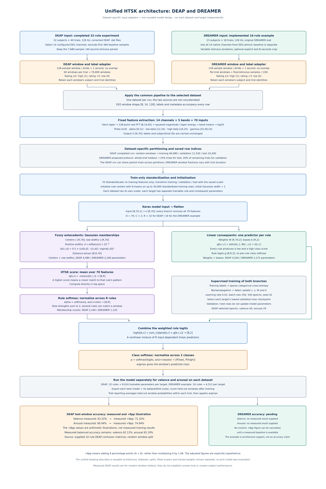
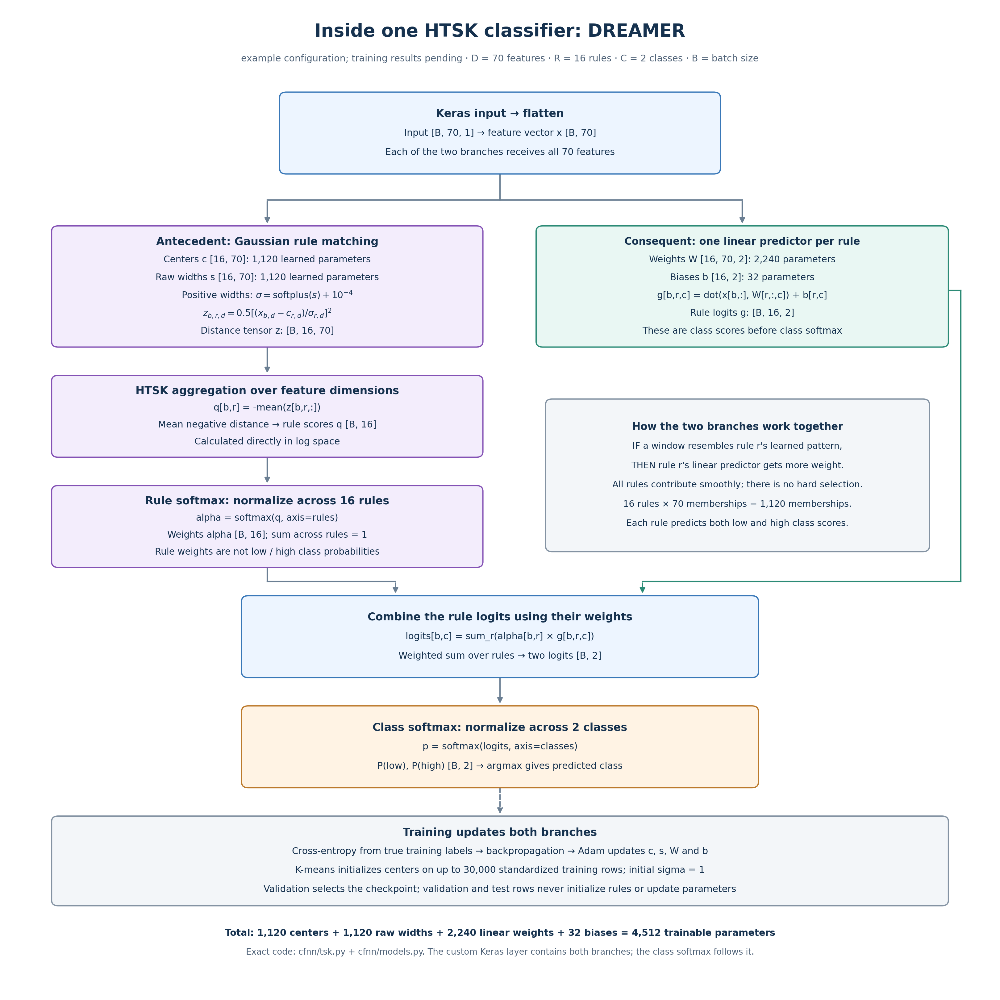

# HTSK architecture for DEAP and DREAMER

The diagrams now cover both datasets as separate experiments. The DEAP lane
describes the completed 32-rule experiment. The DREAMER lane describes the
implemented 16-rule example configuration; no completed DREAMER training result
has been provided. The HTSK computation is the same in both lanes, with the
rule count configurable for either dataset.

The detailed DEAP sections describe the implementation used for the last completed
DEAP experiment: corrected DEAP ratings, 128-sample windows, 70 input features,
32 fuzzy rules, and random window splitting. It describes a standalone first-order
high-dimensional Takagi-Sugeno-Kang (HTSK) classifier. This is an independent
implementation of HTSK principles, distinct from the original CFNN architecture
in the reproduction guide. The original CFNN paper's reported accuracy is not an
HTSK result or a predicted accuracy for this implementation.

Two independent classifiers are trained: one predicts low/high valence, and one
predicts low/high arousal. They use the same extracted features, partitions and
scaler, but learn separate parameters. They are not a single four-class model.

Downloadable figures:

- [Unified complete architecture, including measured accuracy and the +8pp illustration (SVG)](diagrams/htsk_unified_complete_architecture.svg)
- [Unified complete architecture, including measured accuracy and the +8pp illustration (PNG)](diagrams/htsk_unified_complete_architecture.png)
- [DEAP and DREAMER comparison pipeline (SVG)](diagrams/htsk_deap_dreamer_pipeline.svg)
- [DEAP and DREAMER comparison pipeline (PNG)](diagrams/htsk_deap_dreamer_pipeline.png)
- [DREAMER classifier: 16 rules (SVG)](diagrams/htsk_dreamer_rule_architecture.svg)
- [DREAMER classifier: 16 rules (PNG)](diagrams/htsk_dreamer_rule_architecture.png)
- [DEAP complete data/training pipeline (SVG)](diagrams/htsk_deap_pipeline.svg)
- [DEAP complete data/training pipeline (PNG)](diagrams/htsk_deap_pipeline.png)
- [DEAP classifier: 32 rules (SVG)](diagrams/htsk_rule_architecture.svg)
- [DEAP classifier: 32 rules (PNG)](diagrams/htsk_rule_architecture.png)



The SVGs contain scalable vector shapes and text. Render them again with
`python docs/render_htsk_architecture.py` in an environment with matplotlib.
The rendering script does not load data or train a model.

## Accuracy in the unified diagram

The unified figure includes dataset-specific input handling, spectral features,
partitioning, train-only scaling and K-means initialization, the Gaussian and
linear branches, both softmax operations, training/checkpointing, separate target
models, and evaluation. It represents the same reusable pipeline applied to one
dataset at a time. It does not describe pooled DEAP+DREAMER training or a single
model evaluated jointly on both datasets.

The measured base values below are calculated from the supplied DEAP 32-rule
confusion matrices. The requested "measured +8" column is an explicit arithmetic
illustration: measured accuracy plus **8 percentage points**. It is not a newly
measured result, a forecast, or an improvement obtained by combining diagrams.

| Dataset / target | Measured window accuracy | Measured +8pp: hypothetical illustration |
| --- | ---: | ---: |
| DEAP valence | 63.32% | 71.32% |
| DEAP arousal | 66.94% | 74.94% |
| DREAMER valence | Pending | Pending a measured baseline |
| DREAMER arousal | Pending | Pending a measured baseline |

Eight percentage points means `A + 8`, with A expressed as a percentage. An
8% relative increase would instead mean `A * 1.08` and would give different
values. The measured balanced accuracies remain 62.12% for valence and 65.19%
for arousal. No experiment artifacts, predictions, histories or trained model
weights are changed by this visualization. Numeric provenance and the status
of the adjustment are recorded in
[htsk_unified_accuracy_provenance.json](diagrams/htsk_unified_accuracy_provenance.json).

## How DREAMER fits into the architecture

Both datasets use 128-sample EEG windows, 70 log band-power features, a train-only
scaler, Gaussian rule matching, linear consequents and class softmax. Each dataset
has its own feature rows, splits, scaler and learned model weights. The two
dataset lanes are not pooled into a common training set.

| Setting | Last completed DEAP run | Implemented DREAMER example |
| --- | --- | --- |
| Source | Corrected DEAP subject `.dat` files | Original `DREAMER.mat` |
| Subjects / trials per subject | 32 / 40 | 23 / 18 |
| Sample rate | 128 Hz | 128 Hz |
| EEG channels | 14 configured DEAP indices | 14 native DREAMER channels |
| Stimulus selection | Exclude first 3 s; use 60 s | Use separate `EEG.stimuli`; all durations by default |
| Rating scale | 1..9 | 1..5 |
| Default binary labels | High >=5; low <5 | High >=3; low <3 |
| Window / stride | 128 / 128 samples | 128 / 128 samples |
| Window count | 76,800 | Determined from actual stimulus lengths |
| Spectral features | 70 | 70 |
| Split shown | Random windows | Proposed whole-trial holdout |
| Rules | 32 | 16, configurable |
| Parameters per target | 9,024 | 4,512 |
| Classifiers | Separate valence and arousal models | Separate valence and arousal models |
| Status | Completed results supplied | Loader implemented; training results pending |

DREAMER's baseline is a separate field, so the loader reads `EEG.stimuli`
without discarding the first 384 stimulus samples. All stimulus samples are used
by default. A positive `--dreamer-last-seconds` selects the end of each trial
explicitly. Each one-second window remains within its parent trial. Longer
recordings contribute more windows. No extra baseline correction or artifact
removal is performed by this adapter.

The channel order is AF3, F7, F3, FC5, T7, P7, O1, O2, P8, T8, FC6, F4, F8, AF4.
The loader validates/reorders electrode metadata when it is present. DREAMER
ratings are read directly, and the DEAP label-repair procedure is not applied.
These behaviors are implemented in `cfnn/dreamer.py`.

The proposed DREAMER command uses `--split trial`, keeping whole trials separate
between training, validation and test. With variable trial durations, the
fractions of windows need not equal the fractions of held-out trials. A random
window split remains available as a separately reported protocol.

The 16-rule DREAMER classifier has the following trainable tensors:

| Parameter | Shape | Count |
| --- | --- | ---: |
| Gaussian centers | [16, 70] | 1,120 |
| Raw widths | [16, 70] | 1,120 |
| Consequent weights | [16, 70, 2] | 2,240 |
| Consequent biases | [16, 2] | 32 |
| **Total per target** | | **4,512** |

There are 1,120 Gaussian memberships per DREAMER classifier in this example.
The two target models together have 9,024 learned parameters. Choosing 32 rules
instead produces 9,024 parameters per target, just as in the DEAP example.
The rule count is an experimental setting rather than a dataset requirement.



The detailed derivation below uses the completed DEAP case with D=70, R=32 and
C=2. DREAMER uses the same equations; replace R with 16 for the illustrated
configuration. Report the different dataset/split settings alongside results.

## DEAP data and fixed feature extraction

The preprocessed DEAP input contains 32 subjects, each with 40 trials. Each trial
has 40 recorded channels and 8,064 time samples at 128 Hz. The implementation
selects the following 14 one-based channel indices from the supplied guide:

```text
1, 2, 3, 4, 6, 11, 13, 17, 19, 20, 21, 25, 29, 31
```

These are the literal indices from this code's configuration, not a claim that
all 14 have the same montage positions as a different dataset. The first 384
samples (3 seconds of baseline) are excluded. The remaining 7,680 samples are
the 60-second stimulus period.

For this run, the window and stride are both 128 samples: one second without
overlap. Each trial therefore produces 60 windows, for 76,800 windows total.
Every window inherits the valence/arousal ratings of its parent trial. A rating
of at least 5 is high (class 1); a rating below 5 is low (class 0).

For each channel of each window, the feature extractor:

1. Multiplies 128 samples by a Hann taper.
2. Computes a real FFT of length 128, producing 65 frequency bins.
3. Computes squared FFT magnitude, divided by the taper's squared-energy sum
   plus `1e-12`.
4. Averages that power across the bins in each of the five bands below.
5. Computes `log10(mean_band_power + 1e-12)`.

| Band | Frequency interval in this code |
| --- | --- |
| Theta | 4 <= f < 8 Hz |
| Alpha | 8 <= f < 12 Hz |
| Low beta | 12 <= f < 16 Hz |
| High beta | 16 <= f < 25 Hz |
| Gamma | 25 <= f <= 45 Hz |

Each window becomes a vector of 14 × 5 = 70 features. Ordering is channel-major:
the five band powers for channel 1, then the five for channel 2, and so on.
There are no three extra padding columns in this 70-feature HTSK configuration.
The spectral transform is fixed; gradient descent does not learn it.

## Partitioning and standardization

With `--split random --seed 42` and the default test/validation fractions:

| Partition | Fraction of all windows | Windows |
| --- | ---: | ---: |
| Training | 60% | 46,080 |
| Validation | 15% | 11,520 |
| Test | 25% | 19,200 |

The outer split reserves 25% for testing. Validation takes 20% of the remaining
75%, so it is 15% of the whole dataset. The same row partitions are used for
both target classifiers.

`StandardScaler` fits each feature's mean and standard deviation on training
rows only. It then applies the same transformation to training, validation and
test features. For a nonconstant feature:

\[
x_d = \frac{f_d - \mu_d^{\mathrm{train}}}{s_d^{\mathrm{train}}}.
\]

The scaler is preprocessing state, stored separately from the Keras classifier.
Its statistics are not trainable classifier parameters. A new window must use
these saved statistics, rather than being independently standardized.

The random split keeps row indices disjoint, but can include different windows
of the same trial in training, validation and testing. It therefore evaluates
held-out windows under this protocol. It does not establish generalization to
unseen trials or unseen subjects.

## The Keras architecture and tensor shapes

Let B be the batch size, D = 70 input features, R = 32 rules, and C = 2 classes.

```text
Input(shape=(70, 1))
    -> Flatten()
    -> HTSKClassifier(n_rules=32, n_classes=2)
    -> Softmax(axis=-1)
```

The singleton input dimension keeps the public input format consistent with
the other models in the project. The 70 positions are spectral features, not
70 recurrent time steps. The custom HTSK layer contains both the antecedent and
consequent computations in the detailed figure.

| Operation | Output shape | Trainable parameters |
| --- | --- | ---: |
| Keras input | [B, 70, 1] | 0 |
| Flatten | [B, 70] | 0 |
| Gaussian distances for every rule/feature | [B, 32, 70] | 4,480: centers and raw widths |
| Mean negative distance across features | [B, 32] | 0 |
| Rule softmax across 32 rules | [B, 32] | 0 |
| Parallel rule-specific linear consequents | [B, 32, 2] | 4,544: linear weights and biases |
| Weighted sum across rules | [B, 2] | 0 |
| Class softmax across two classes | [B, 2] | 0 |
| **Total per classifier** | | **9,024** |

The linear consequents receive the standardized 70-feature vector directly.
They do not receive the Gaussian membership tensor as their input. The two
branches meet only when their outputs are combined by the weighted sum.

## What makes a rule fuzzy

The antecedent is the IF part of a rule: how well the current feature vector
matches that rule's learned input pattern. Every rule has one Gaussian
membership function per input feature. There are 32 × 70 = 2,240 memberships.
The number 32 refers to rules, not EEG channels, classes or individual memberships.

For feature d in rule r, the Gaussian center is c[r,d], and the positive width
is sigma[r,d]. The implementation stores an unconstrained raw parameter s and
transforms it into a positive width:

\[
\sigma_{r,d}=\operatorname{softplus}(s_{r,d})+10^{-4}.
\]

The corresponding membership can be understood as

\[
\mu_{r,d}(x_d)=\exp\left[-\frac12\left(\frac{x_d-c_{r,d}}{\sigma_{r,d}}\right)^2\right].
\]

An input near the center has high membership. A more distant input has lower
membership, with width controlling how quickly it falls. Membership is a graded
match to an input pattern; it is not a calibrated probability of an emotion.

The code computes the distance term directly:

\[
z_{r,d}=\frac12\left(\frac{x_d-c_{r,d}}{\sigma_{r,d}}\right)^2.
\]

It then averages the negative distances over features:

\[
q_r=-\frac{1}{70}\sum_{d=1}^{70}z_{r,d},
\qquad
\alpha_r=\frac{\exp(q_r)}{\sum_{j=1}^{32}\exp(q_j)}.
\]

The alpha values are the normalized rule strengths. They are positive and sum
to one over the 32 rules. An input can match several rules to different degrees.
There is no hard assignment to a single rule.

The mean across dimensions is the HTSK feature aggregation. It is equivalent
to taking the geometric mean of the memberships before normalization, while
the implementation stays in log space until a numerically stable softmax. The
HTSK paper introduces this averaging to reduce dimension-driven saturation of
the rule softmax. It does not imply guaranteed EEG accuracy.
[Cui, Wu and Xu, 2021, Section III-B](https://arxiv.org/html/2102.04271v1#S3.SS2)

## What each rule predicts

The consequent is the THEN part of a rule. In this first-order model, each rule
has two linear functions of the 70 input features: one for the low class and
one for the high class:

\[
g_{r,c}(x)=\sum_{d=1}^{70}x_d W_{r,d,c}+b_{r,c},
\qquad c\in\{0,1\}.
\]

Each rule produces two raw scores, also called logits. They need not be between
zero and one, and no class softmax is applied separately to each rule.

The rule strengths combine these scores:

\[
\ell_c(x)=\sum_{r=1}^{32}\alpha_r(x)g_{r,c}(x).
\]

Finally, class softmax converts the two combined scores into low/high outputs:

\[
p_c(x)=\frac{\exp(\ell_c(x))}{\exp(\ell_0(x))+\exp(\ell_1(x))},
\qquad
\hat y=\operatorname{argmax}_{c\in\{0,1\}}p_c(x).
\]

There are two different softmax operations: rule softmax chooses relative
contributions among 32 rules; class softmax normalizes the two final class
scores. The output is a model probability vector; calibration has not been
established by the reported accuracy metrics.

An intuitive description is a group of 32 local linear predictors with smooth
fuzzy weights. Each predictor responds to the same input vector, while its
rule strength says how relevant its learned input region is for that window.
Although each consequent is linear, the complete model is nonlinear because
its mixing weights depend nonlinearly on the input. The general antecedent /
consequent construction is also described in the
[PyTSK model documentation](https://pytskdocs.readthedocs.io/en/latest/models.html).

For an illustrative two-rule version (not an output from the trained model),
suppose rule strengths are 0.75 and 0.25, and their low/high logits are [0, 2]
and [2, 0]. The combined logits are [0.5, 1.5]. Class softmax gives approximately
[0.269, 0.731], so the prediction is high. The real model performs this weighted
combination across all 32 rules.

## Learned parameters and initialization

| Parameter tensor | Shape | Count | Role |
| --- | --- | ---: | --- |
| Gaussian centers c | [32, 70] | 2,240 | Rule locations in standardized feature space |
| Raw Gaussian widths s | [32, 70] | 2,240 | Learn the extent of each membership |
| Consequent weights W | [32, 70, 2] | 4,480 | Rule-specific feature-to-class coefficients |
| Consequent biases b | [32, 2] | 64 | Rule-specific class offsets |
| **Total** | | **9,024** | Per target classifier |

For R rules and D features with two classes, the count is R(4D + 2).
Both classifiers together contain 18,048 learned scalar parameters. No classifier
parameter tensor is frozen; there is no batch-normalization moving state here.

Before training, K-means initializes 32 centers using at most 30,000 standardized
training feature vectors. Sampling and K-means use seed 42; K-means uses five
initializations. Labels are not needed for this initialization. Gaussian widths
start at 1 in standardized units. Consequent weights start from zero-mean
Gaussian random values with standard deviation sqrt(2/70), and biases start at
zero. Centers and widths continue to change during supervised training; the
K-means assignments are not fixed predictions.

## How the neural training works

For each target independently, a batch of training windows passes through both
branches and produces low/high probabilities. Sparse categorical cross-entropy
compares the probabilities to the integer training labels:

\[
\mathcal L=-\frac{1}{B}\sum_{i=1}^{B}\log p_{i,y_i}.
\]

Backpropagation differentiates this loss through the class softmax, weighted
combination, consequent functions and Gaussian rule strengths. Adam updates
centers, raw widths, linear weights and biases. That differentiable supervised
parameter learning is the neural part; the membership functions and graded
rule strengths are the fuzzy part. The preprocessing FFT remains fixed.

| Training setting | Last run |
| --- | --- |
| Optimizer | Adam |
| Learning rate | 0.01 |
| Batch size | 256 |
| Epoch budget / epochs run | 100 / 100 |
| Shuffle training batches | Yes |
| Seed | 42 |
| Validation selection | Minimum validation cross-entropy loss |
| Class weighting | None |
| Added regularization | No BN, dropout, DropRule, uniform regularization or weight decay |
| Gradient clipping | Disabled by default |

Validation is a forward evaluation after each epoch and does not update the
parameters. The trainer saves the checkpoint with the lowest validation loss,
reloads those weights after training, then predicts the test windows. The last
epoch is therefore not necessarily the exported model.

In the user's last 32-rule run, the selected checkpoints were epoch 40 for
valence and epoch 29 for arousal. These observations describe this run, not a
general optimum for the architecture.

## How to read the reported results

Window-level predictions use argmax of each window's two class probabilities.
Trial-level reporting first averages the held-out windows' probabilities within
each parent trial, then applies argmax. It does not average hard labels or
logits. Under random window splitting, these parent trials may also be
represented in the training partition.

The supplied confusion matrices give the following test-window accuracies:

| Target | Window accuracy | Window balanced accuracy | High recall | Low recall | Trial balanced accuracy |
| --- | ---: | ---: | ---: | ---: | ---: |
| Valence | 63.32% | 62.12% | 71.99% | 52.26% | 67.34% |
| Arousal | 66.94% | 65.19% | 75.03% | 55.34% | 68.74% |

Accuracy is the fraction of windows classified correctly. Balanced accuracy is
the average of low-class recall and high-class recall, so both classes receive
equal weight. These are single-split results, not a confidence interval or
evidence of performance on new subjects.

The input representation contains five band-power summaries per channel from
one second at a time. It does not retain the full waveform or Fourier phase,
and the classifier does not learn temporal context across windows.
The rules are learned numeric patterns in a 70-dimensional feature space; they
are not automatically verified statements about particular brain mechanisms.

## Explaining it to a teacher

"I extract five frequency-band power features from each of 14 EEG channels,
giving 70 features for every one-second window. After standardizing the
features using training data, I use an HTSK neurofuzzy classifier with 32 learned
rules. Each rule has Gaussian membership functions that determine how strongly
it matches a window, and a linear function that predicts low/high class scores.
The model combines those scores using the normalized rule strengths, then
applies softmax to obtain its prediction. Gaussian parameters and linear
parameters are learned together using backpropagation. I train separate models
for valence and arousal, each with 9,024 parameters. The reported experiment uses
random window splitting, so its results concern held-out windows rather than
unseen subjects."

## Files that implement and store the model

- `cfnn/constants.py`: DEAP channel indices, bands and sample rate.
- `cfnn/data.py`: DEAP reading, baseline exclusion, row identities and labels.
- `cfnn/features.py`: windowing, FFT and log band-power features.
- `cfnn/experiment.py`: row splits, train-only scaling, target-specific training
  and result artifacts.
- `cfnn/tsk.py`: K-means initialization and differentiable HTSK classifier.
- `cfnn/models.py`: Input -> Flatten -> HTSKClassifier -> class Softmax.
- `cfnn/training.py`: Adam, loss, checkpointing and export.
- `cfnn/metrics.py`: window and trial aggregation/reporting.

The completed Colab run directory contains `htsk_valence_f0.keras`,
`htsk_arousal_f0.keras` and `scaler_f0.joblib`, plus configuration, feature
manifest and split files. The saved `.keras` files take spectral features,
not raw EEG. Reuse the same feature extraction and saved scaler for inference.
Import `cfnn.models` before loading with Keras so that the custom layer is
registered. This documentation does not include or recreate the trained weights
stored on the user's Colab/Drive runtime.
